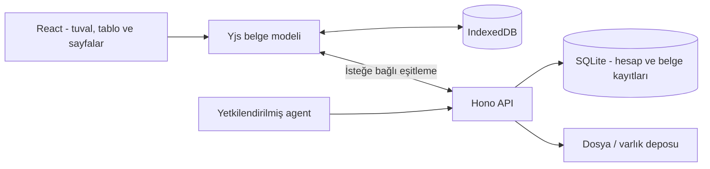

# Gridpen

**Tabloların ve çalışma düzenin bir arada.**

Gridpen; tabloları, hesaplamaları, grafik ve notları sonsuz bir tuvalde birleştirir.
Sayfalar, çizimler ve veri birbirine bağlanabilir; bir tablo değişince ona bağlı
grafik de aynı çalışma alanında güncellenir.

| Bağlantı | Kullanım |
| --- | --- |
| [Canlı uygulama](https://gridpen.mehmetfatihdogan.com.tr/app) | Hesapla çalışma alanına erişim |
| [Etkileşimli demo](https://gridpen.mehmetfatihdogan.com.tr/demo?node=finance) | Örnek finans panosunu tarayıcıda deneme |
| [Tanıtım sitesi](https://gridpen.mehmetfatihdogan.com.tr/) | Özellikler ve ürün anlatımı |

## Özellikler

- **Sonsuz tuval:** şekiller, kalem, bağlantılar, notlar, çerçeveler ve hizalama araçları.
- **Tablolar ve hesaplama:** hücre düzenleme, formüller, sıralama/filtreleme ve veri içe/dışa aktarma.
- **Veriye bağlı grafikler:** tabloları grafiklerle aynı panoda yorumlama.
- **Zengin metin sayfaları:** görev listeleri, kod blokları, matematik ve dosyalar.
- **Belge araçları:** PDF görüntüleme ve pano/sayfa dışa aktarımları.
- **Çalışma alanları:** pano ve sayfa düzeni, arama, çöp kutusu ve yedekleme.
- **Çevrimdışı çalışma ve eşitleme:** cihazda kayıt, isteğe bağlı bulut eşitlemesi; Türkçe/İngilizce ve açık/koyu tema.
- **Agent API:** kapsamlandırılmış erişimle çalışma alanı, belge ve tablo işlemleri.

Mobil görünüm

## Teknoloji

| Katman | Teknoloji ve görevi |
| --- | --- |
| Arayüz | React, TypeScript, Vite; tuval ve düzenleme araçları |
| Belge modeli | Yjs; CRDT tabanlı belge durumu |
| Yerel kayıt | IndexedDB, y-indexeddb; cihazda kalıcı belge kayıtları |
| Hesap ve API | Node.js, Hono, SQLite; oturum, erişim ve eşitleme |
| Hesaplama ve görselleştirme | Kendi Excel sözdizimli formül motoru, Formula.js, ECharts |
| Metin / kod / PDF | Tiptap, CodeMirror, PDF.js, KaTeX |
| Kontroller | Vitest, Playwright ve TypeScript |

## Mimari

Yjs belge modeli yerel çalışma ile sunucu eşitlemesi arasında ortak veri biçimidir.
Tablo hesaplama, grafik ve metin düzenleme katmanları bu model üzerinde çalışır.
Agent erişimi, hesap oturumundan ayrı ve yetki kapsamıyla sınırlandırılır.

## Geliştirici

**Mehmet Fatih Doğan** — ürün tasarımı, tuval ve belge modeli, hesaplama/grafik
entegrasyonları, API, veri eşitleme, testler ve dağıtım.

[Portfolyo ve iletişim](https://mehmetfatihdogan.com.tr/) · [GitHub](https://github.com/fatihdogann)

Bu depo ürün tanıtımı ve mimari özetini içerir. Görseller örnek pano verileridir;
gizlilik ve kullanım koşulları canlı sitededir.
