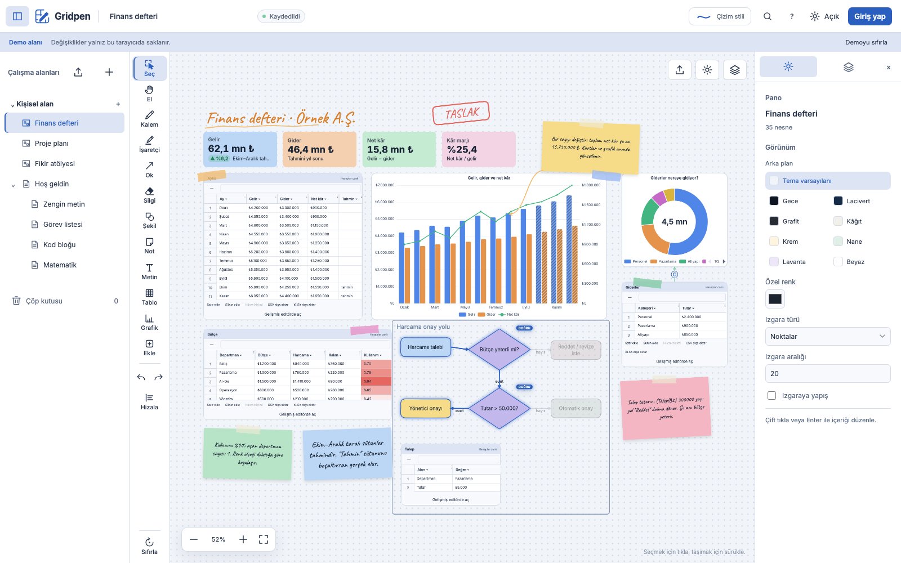
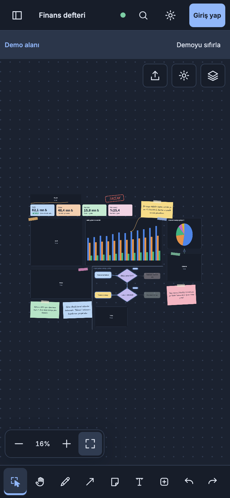
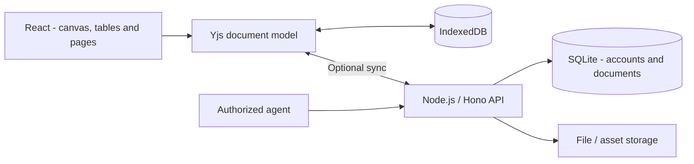

# Gridpen

**English** · [Türkçe](README.tr.md)

**Think, calculate and visualize in one workspace.**

Gridpen combines tables, formulas, charts and notes on an infinite canvas.
Pages, diagrams and data can connect; editing a table updates its linked chart
in the same workspace.

| Link | Access |
| --- | --- |
| [Live app](https://gridpen.mehmetfatihdogan.com.tr/app) | Account-based workspace access |
| [Interactive demo](https://gridpen.mehmetfatihdogan.com.tr/demo?node=finance) | Explore a sample finance board in your browser |
| [Product website](https://gridpen.mehmetfatihdogan.com.tr/) | Features and product overview |

## Features

- **Infinite canvas:** shapes, drawing, connectors, notes, frames and alignment tools.
- **Tables and formulas:** cell editing, calculations, sorting/filtering and data import/export.
- **Linked charts:** visualize table data on the same board.
- **Rich-text pages:** task lists, code blocks, math and files.
- **Document tools:** PDF viewing and board/page exports.
- **Workspaces:** organize boards and pages, search, trash and backups.
- **Offline work and sync:** local persistence, optional cloud sync, Turkish/English and light/dark themes.
- **Agent API:** scoped access to workspace, document and table operations.

Mobile view

## Technology

| Layer | Technology and purpose |
| --- | --- |
| Interface | React, TypeScript, Vite; canvas and editing tools |
| Document model | Yjs; CRDT-based document state |
| Local persistence | IndexedDB, y-indexeddb; on-device document storage |
| Accounts and API | Node.js, Hono, SQLite; sessions, access and synchronization |
| Calculation and visualization | Custom Excel-syntax formula engine, Formula.js, ECharts |
| Text / code / PDF | Tiptap, CodeMirror, PDF.js, KaTeX |
| Checks | Vitest, Playwright and TypeScript |

## Architecture

The Yjs document model provides a shared data format for local editing and server
sync. Calculation, visualization and text editing operate on that model.
Agent access uses separate credentials and permission scopes from account sessions.

## Developer

**Mehmet Fatih Doğan** — product design, canvas and document model,
calculation/chart integrations, API, synchronization, tests and deployment.

[Portfolio & contact](https://mehmetfatihdogan.com.tr/en/) · [GitHub](https://github.com/fatihdogann)

This repository contains the product showcase and architecture overview.
Screenshots show sample boards; privacy policies and terms are available on the live site.
